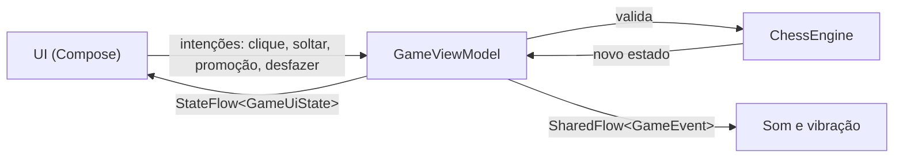

<div align="center">


<br/>

**Xadrez local para 2 jogadores (Pass-and-Play) em Kotlin + Jetpack Compose + Material 3.**


<br/>

<a href="#como-abrir"></a>
<a href="#como-debugar"></a>
<br/>
<a href="#como-abrir"></a>
<a href="#personalizacao"></a>

</div>


## Em ação

<div align="center">

<sub>O mate do tolo (1. f3 e5 2. g4 Dh4#), o mesmo cenário coberto pelos testes do motor.</sub>
</div>


## Identidade visual

Cada tipo de botão tem uma cor própria para que as ações não se confundam:

<div align="center">
</div>

| Cor | Uso sugerido na interface |
|---|---|
| **Violeta** `#7C5CFF` | Ação principal (Nova partida, Jogar) |
| **Ciano** `#22D3EE` | Ações de apoio (Desfazer, Dica, Girar tabuleiro) |
| **Rosa** `#FF5CAA` | Ações de atenção (Desistir, Empate, Reiniciar) |
| **Ouro** `#FFC857` | Destaques (Promoção, Último lance, Vitória) |
| **Nyx Night** `#0B0B1A` | Fundo e superfícies escuras |


## Como abrir

1. Abra a pasta `NyxChess` no Android Studio (Ladybug ou mais recente, JDK 17).
2. Aguarde o Gradle Sync (o Android Studio gera o `gradle-wrapper.jar` sozinho).
3. Rode no emulador ou aparelho com Android 7.0 (API 24) ou superior.
4. Para testar o motor de regras: `./gradlew test` (inclui perft e mate do tolo).

## Como debugar

1. Selecione a configuração `app` e o build variant `debug` (**View > Tool Windows > Build Variants**).
2. Clique no ícone de bug (**Debug 'app'**) ou `Shift+F9`; clique na margem esquerda do código para pôr breakpoints.
3. Os testes do motor também rodam em debug: clique direito em `ChessEngineTest` > **Debug**.
4. `ui-tooling` está incluído no debug (Layout Inspector e `@Preview`).


## Estrutura

```text
app/src/main/java/.../
├── domain/
│   ├── model/        Piece, Move, Position, GameStatus
│   └── engine/       ChessEngine (regras puras, sem Android; SAN incluso)
├── presentation/     GameViewModel (StateFlow de GameUiState + SharedFlow de GameEvent), GameState
├── ui/
│   ├── theme/        Tema Material 3 (cores dinâmicas) e paletas do tabuleiro
│   ├── components/   ChessBoard (Canvas, animações, arrastar e soltar), PieceGlyph, Hud
│   └── screens/      MenuScreen e GameScreen (promoção, fim de jogo, controles)
└── util/             SoundPlayer
```

### Fluxo de dados



A UI envia intenções ao ViewModel (clique, soltar peça, promoção, desfazer). O ViewModel valida com o `ChessEngine`, atualiza o `GameUiState` e emite `GameEvent` para som e vibração.


## Personalização

1. **Novos temas de tabuleiro:** adicione um item em `BoardTheme` (`BoardPalette.kt`).
2. **Sons reais:** troque o `SoundPlayer` por `SoundPool` com arquivos `.ogg` em `res/raw`.
3. **Novos controles de tempo:** adicione itens em `TimeControl` (`GameState.kt`).


## Uma breve história do xadrez

| Época | Marco |
|---|---|
| **~séc. VI** | Na Índia nasce o *chaturanga*, jogo que representava os exércitos indianos: infantaria, cavalaria, elefantes e carruagens. É o ancestral direto do xadrez. |
| **Séc. VII** | O jogo chega à Pérsia e vira o *shatranj*. A expressão persa *shāh māt* ("o rei está indefeso") deu origem a "xeque-mate". |
| **Séc. VIII-X** | Com a expansão árabe, o jogo se espalha pelo Norte da África e pela península Ibérica e chega à Europa. |
| **Fim do séc. XV** | Nasce o xadrez moderno: a dama e o bispo ganham seu alcance atual, o que torna as partidas muito mais rápidas e dinâmicas. |
| **1886** | Wilhelm Steinitz vence o primeiro Campeonato Mundial oficial. |
| **1924** | Fundação da FIDE, a federação internacional que organiza o xadrez até hoje. |
| **1997** | O computador Deep Blue vence o campeão mundial Garry Kasparov em uma partida de match. |
| **2017** | O AlphaZero aprende xadrez sozinho, jogando contra si mesmo, e supera os melhores motores da época. |

Hoje o xadrez é jogado por milhões de pessoas, de partidas casuais a torneios online. O NyxChess leva essa tradição de mais de 1.500 anos para o seu celular, em modo Pass-and-Play: um aparelho, dois jogadores, um tabuleiro.


<div align="center">

<sub>Feito com Kotlin, Jetpack Compose e Material 3.</sub>

</div>
